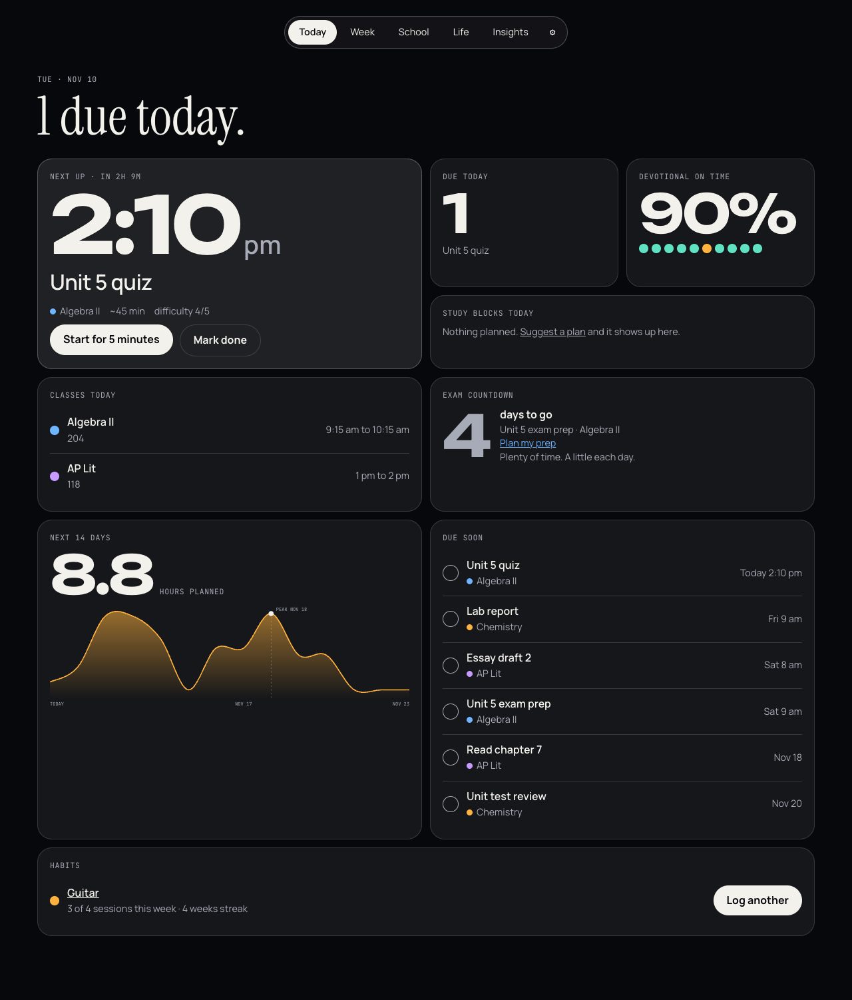
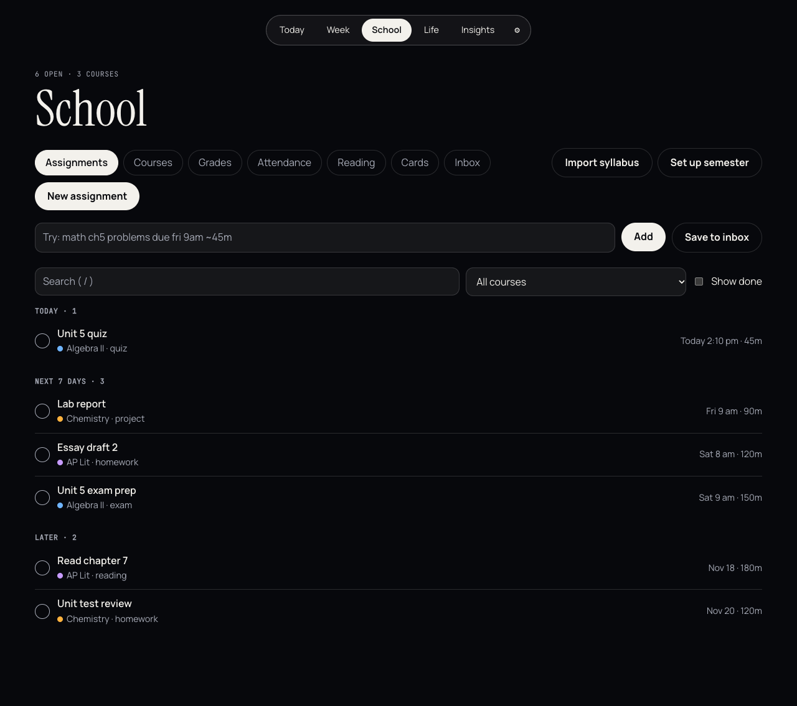
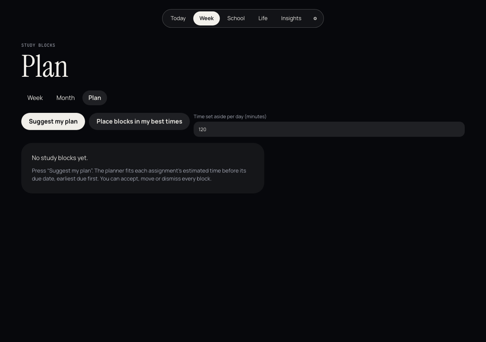
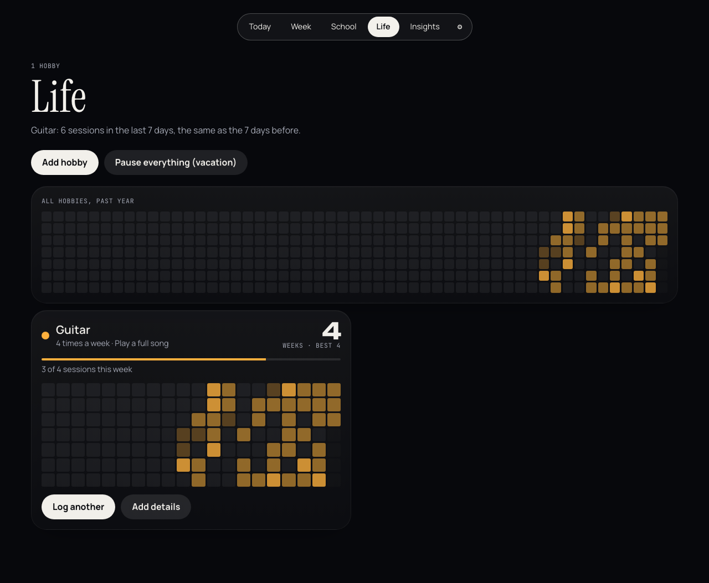
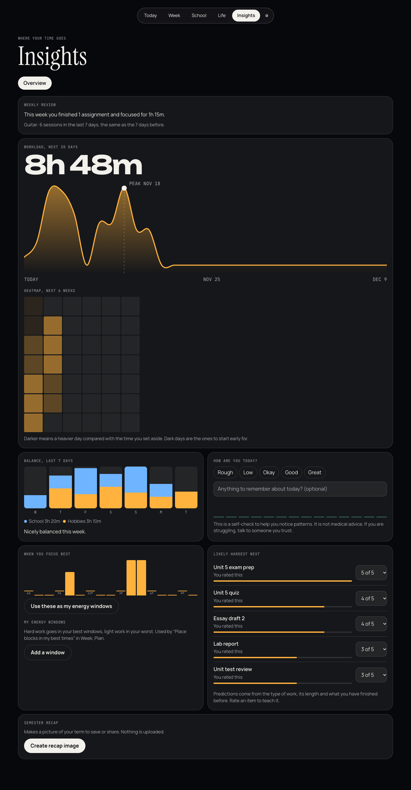

# Studyboard

**Live:** https://studyboard-e7t.pages.dev (installable on your phone; your data stays in your own browser)

A homework planner and hobby tracker in one app. It installs on your phone or laptop as a web app, works offline, needs no account, and keeps your data on your device.

Built for Bryan's AI Mastermind. The plan, spec, research and design history are in [`ROADMAP.md`](ROADMAP.md) and [`docs/`](docs/).



## Run it

You need [Node.js](https://nodejs.org) 20 or newer.

```bash
npm install
npm run dev          # open http://localhost:5173
```

The first launch loads sample data (three courses, a week of assignments, a guitar habit) so every screen has something to show. Settings has "Delete all data" to start fresh and "Reload sample data" to bring it back.

| Command | What it does |
| --- | --- |
| `npm run dev` | Development server with hot reload |
| `npm test` | Unit tests (Vitest) for all the date, streak, scheduling and parsing logic |
| `npm run e2e` | End-to-end and accessibility tests in Chromium, desktop and phone sizes (Playwright). First run: `npx playwright install chromium` |
| `npm run typecheck` / `npm run lint` | TypeScript and ESLint |
| `npm run build` then `npm run preview` | Production build with the offline service worker, served at http://localhost:4173 |
| `npm run screenshots` | Refreshes the images in `docs/screenshots/` |

To install it as an app, open the production build in Chrome, Edge or Safari and choose "Install" or "Add to Home Screen".

## What it does

**Today** shows only what matters now: what is next and how long until it is due, classes today, study blocks, an exam countdown, devotional on-time dots, the workload for the next 14 days, what is due soon, and one-tap hobby check-ins. "Start for 5 minutes" opens a focus timer on the next assignment.

**School**
- Add assignments with one sentence: `math ch5 problems due fri 9am ~45m` fills in the course, date, time and estimate.
- Courses with weekly, block or A/B rotating timetables. Share a course with classmates as a file.
- Grades with custom scales and a "what do I need on the final" calculator.
- Attendance for devotional, school and each class, with on-time rates and how many classes you can still miss.
- Reading tracker (pages a day to finish on time), flashcards with spaced repetition that always come back before the exam, class notes, and a quick-capture inbox.
- Import a syllabus: paste it or pick a .docx, .pptx or .txt file and review what was found before anything is saved.

**Week** has week and month calendars and a Plan tab that suggests study blocks before each due date (accept, move or dismiss), warns about overloaded days, and can put hard work in your best hours.

**Life** tracks hobbies with flexible goals (every day, certain weekdays, N times a week, or minutes a week). Streaks forgive one missed day, freezes and vacation mode never count against you, and a GitHub-style heatmap keeps every good day visible. Each hobby has stats, a journal, milestones and progress photos.

**Insights** has a weekly review, workload chart and heatmap, a school vs hobby balance chart, a mood check-in with a gentle burnout signal (self-tracking, not medical advice), the hours you focus best, the assignments likely to be hardest and why, and a semester recap image. The optional game layer adds XP, levels, badges, weekly quests and a friends leaderboard, and never takes anything away for a missed day.

**Settings** covers theme, week start, reminders (in the app, plus system notifications if you allow them), tone (gentle, balanced or strict), JSON backup and restore, and calendar (.ics) and CSV import and export.

Keyboard: `n` new assignment, `t` today, `/` search.

| | |
| --- | --- |
|  |  |
|  |  |

## AI and privacy

Everything works without AI and without the internet. AI is off by default. If you turn it on in Settings and paste your own Anthropic API key, the syllabus importer can also read PDFs and messy syllabi, and assignments can suggest steps. Only what you choose to send goes to Anthropic: that syllabus or that one assignment, today's date and your course names. Every AI result is a preview you can edit or throw away. The key is stored only in your browser and is never part of a backup.

## How it is built

- React, TypeScript and Vite, installed as a PWA with an offline service worker.
- Data lives in IndexedDB (through Dexie) behind a small repository interface, so the storage can be swapped later.
- `src/domain/` holds the logic as pure, tested functions: local dates, streaks, quick-add parsing, schedules and A/B rotations, reminders, workload, the study planner, exam prep, grades, Pomodoro, reading pace, attendance, game rules, balance, difficulty prediction, energy windows, wellbeing, ICS and CSV, flashcards and sharing.
- `src/features/` has one folder per screen; `src/ui/` holds the theme and shared pieces.
- Dates are stored as local `YYYY-MM-DD` strings, so travel, daylight saving changes and midnight never break a streak.
- No network calls except loading the app, and the optional AI requests you start yourself. Fonts are bundled.

## Status

All seven phases of the [roadmap](ROADMAP.md) are built: foundations and design system, assignments, hobbies, planning, insights and game, AI and flashcards, and polish. Not built yet, by design: syncing between devices (needs a server; the merge rules exist and are tested), live "study with friends" sessions, and direct Canvas, Google Classroom or Moodle import. See [`docs/DECISIONS.md`](docs/DECISIONS.md) for every choice made along the way.
